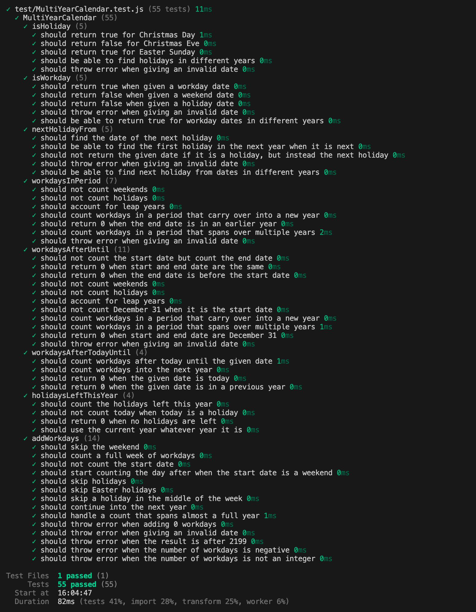
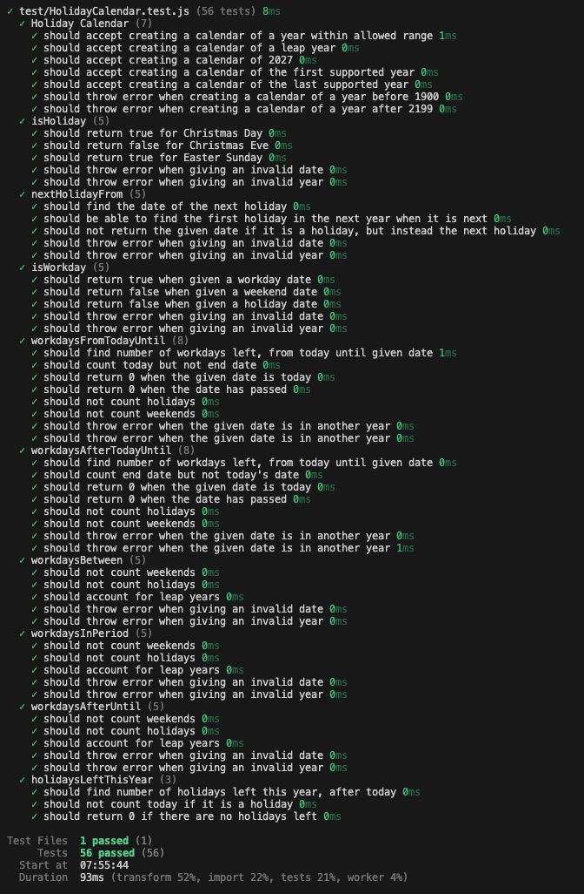

# Test Report

## Summary

The module is tested with automatic tests written in Vitest. All public methods of `HolidayCalendar` and `MultiYearCalendar` are tested, including the deprecated ones, to make sure their behaviour stays the same.

The tests run in Swedish time (`TZ=Europe/Stockholm`), since several bugs only appeared in that time zone. They also run in GitHub Actions on every push.

Tests that depend on today's date use Vitest's fake timers (`vi.setSystemTime`), so they give the same result whenever they run.

## How to run the tests

```bash
npm install
npm test
```

## Test results

### MultiYearCalendar
Last run: 2026-11-04, version 1.2.0. 55 tests, all passing.



| Method | Tests | What is covered | Result |
| --- | --- | --- | --- |
| `isHoliday` | 5 | Fixed and Easter-based holidays, a non-holiday, holidays in different years, invalid date | ✅ Passed |
| `isWorkday` | 5 | Workday, weekend, holiday, workdays in different years, invalid date | ✅ Passed |
| `nextHolidayFrom` | 5 | Next holiday, given date is a holiday, first holiday of next year, dates in different years, invalid date | ✅ Passed |
| `workdaysInPeriod` | 7 | Weekends, holidays, leap year, period across New Year, period across several years, end date in an earlier year, invalid date | ✅ Passed |
| `workdaysAfterUntil` | 11 | Start date not counted and end date counted, same start and end date, end date before start date, weekends, holidays, leap year, December 31 as start date, period across New Year, period across several years, invalid date | ✅ Passed |
| `workdaysAfterTodayUntil` | 4 | Workdays after today, into the next year, given date is today, given date in a previous year | ✅ Passed |
| `holidaysLeftThisYear` | 4 | Holidays left, today is a holiday, no holidays left, works in any current year | ✅ Passed |
| `addWorkdays` | 14 | Weekend, a full week, start date not counted, start date on a weekend, holidays, Easter, holiday mid-week, into the next year, almost a full year, 0 workdays, invalid date, result after 2199, negative and non-integer number of workdays | ✅ Passed |


### HolidayCalendar

Last run: 2026-11-03, version 1.1.0. 56 tests, all passing.



| Method | Tests | What is covered | Result |
| --- | --- | --- | --- |
| `new HolidayCalendar()` | 7 | Supported years, leap year, first and last supported year, years outside 1900–2199 | ✅ Passed |
| `isHoliday` | 5 | Fixed and Easter-based holidays, a non-holiday, invalid date, date in another year | ✅ Passed |
| `nextHolidayFrom` | 5 | Next holiday, given date is a holiday, first holiday of next year, invalid date and year | ✅ Passed |
| `isWorkday` | 5 | Workday, weekend, holiday, invalid date and year | ✅ Passed |
| `workdaysInPeriod` | 5 | Weekends, holidays, leap year, invalid date and year | ✅ Passed |
| `workdaysAfterUntil` | 5 | Weekends, holidays, leap year, invalid date and year | ✅ Passed |
| `workdaysAfterTodayUntil` | 8 | End date counted, today not counted, today, past date, holidays, weekends, another year | ✅ Passed |
| `holidaysLeftThisYear` | 3 | Holidays left, today is a holiday, no holidays left | ✅ Passed |
| `workdaysBetween` (deprecated) | 5 | Same behaviour as before: weekends, holidays, leap year, invalid date and year | ✅ Passed |
| `workdaysFromTodayUntil` (deprecated) | 8 | Same behaviour as before: today counted, end date not counted, holidays, weekends, another year | ✅ Passed |

## History

Up to version 1.0.2 the module was tested manually with a test application (`test-app/app.js`). It was replaced by the automatic tests in version 1.1.0.